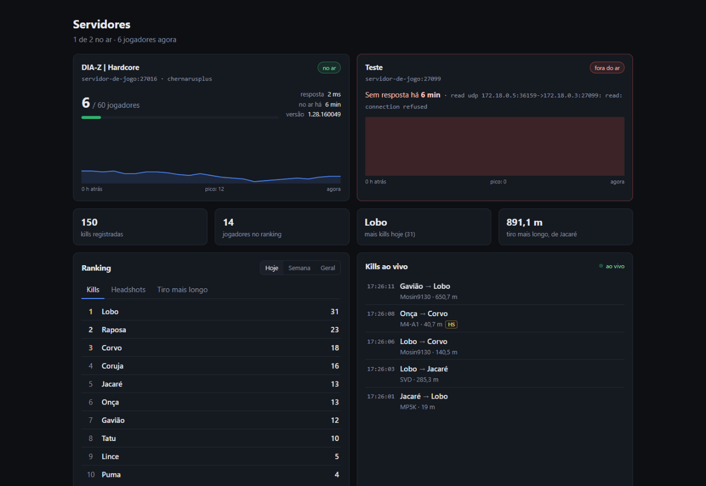

# game-server-stack

Um `docker compose up` que sobe meus projetos de back-end juntos, conversando entre si como
num servidor de jogo de verdade: monitor, ranking ao vivo, painel da equipe, loja e métricas.



```
                       ┌──────────── Nginx (dashboard :8080) ────────────┐
 navegador ──────────▶ │  /            React (server-dashboard)          │
                       │  /api/monitor ─────────▶ a2s-monitor (Go) :9105 ─┼──UDP──▶ servidor-de-jogo (A2S)
                       │  /api/ranking ─────────▶ ranking (Python) :8000 ─┼──────▶ Redis
                       └─────────────────────────────────────────────────┘           ▲
 simulador ──── POST /events/kill ──────────────────────▶ ranking                    │
 relay do mod (killfeed.jsonl) ──── POST /events/kill ──▶ ranking ───────────────────┘
 Prometheus :9090 ──── scrape /metrics ──▶ a2s-monitor
 painel da equipe (PHP) :8090 ──▶ MySQL ◀── loja (C#) :8081
```

| Serviço | Projeto | Porta |
|---|---|---|
| `dashboard` | [server-dashboard](https://github.com/edudiasr/server-dashboard) (React + TypeScript), servido pelo Nginx, que também faz o proxy das duas APIs | 8080 |
| `monitor` | [a2s-monitor](https://github.com/edudiasr/a2s-monitor) (Go) | 9105 |
| `servidor-de-jogo` | o mesmo binário no modo `fake`, respondendo A2S por UDP como um servidor de DayZ | — |
| `ranking` | [realtime-leaderboard-redis](https://github.com/edudiasr/realtime-leaderboard-redis) (Python + Redis) | 8000 |
| `simulador` | gera uma kill a cada 2,5 s pro ranking e o painel terem movimento | — |
| `relay-mod` | relay do [mod de DayZ](https://github.com/edudiasr/dayz-server-stats) mandando o `killfeed.jsonl` de exemplo uma vez | — |
| `painel` | [server-admin-php](https://github.com/edudiasr/server-admin-php) (PHP 8.4 + Apache) | 8090 |
| `loja` | [game-store-mysql](https://github.com/edudiasr/game-store-mysql) (ASP.NET Core) + seed de exemplo | 8081 |
| `prometheus` | coleta as métricas do monitor | 9090 |
| `mysql`, `redis` | um banco e um usuário por serviço no MySQL | — |

## Subindo

```bash
cp .env.example .env     # troque as senhas se for expor alguma porta
docker compose up -d --build
```

Na primeira vez o build leva alguns minutos (são oito imagens, uma delas com o SDK do .NET).
Depois:

- painel ao vivo: http://localhost:8080
- painel da equipe: http://localhost:8090 (usuário `admin`, senha `demonstracao123` com `PAINEL_DEMO=1`)
- documentação da loja: http://localhost:8081/scalar
- Prometheus: http://localhost:9090/graph?g0.expr=a2s_players
- ranking com a página própria dele: http://localhost:8000

O servidor "Teste" aparece fora do ar de propósito: ele aponta pra uma porta onde nada responde,
pra mostrar o monitor detectando a queda (e o histórico vermelho no gráfico).

## Como o código entra

Cada serviço tem só o Dockerfile aqui. O código vem do repositório do projeto, como um contexto
de build adicional (`additional_contexts: src`), que por padrão é a URL do GitHub:

```yaml
ranking:
  build:
    context: ./services/ranking
    additional_contexts:
      src: ${RANKING_SRC:-https://github.com/edudiasr/realtime-leaderboard-redis.git#main}
```

E o Dockerfile copia de lá só o que precisa (`COPY --from=src pyproject.toml ./`). Pra testar uma
mudança antes de subir pro GitHub, basta apontar a variável pra pasta local no `.env`
(`RANKING_SRC=../realtime-leaderboard-redis`). Assim cada projeto continua independente no próprio
repositório, sem submódulo e sem cópia de código.

## Detalhes que deram trabalho

- **SSE atrás do Nginx.** Por padrão o Nginx guarda a resposta em buffer e as kills chegavam em
  lote. A rota `/api/ranking/stream` tem `proxy_buffering off`, HTTP/1.1 sem `Connection: close`
  e `proxy_read_timeout` de 1 h (a API manda um comentário a cada 15 s pra conexão não cair).
- **Mesma origem.** O painel React chama `/api/monitor` e `/api/ranking`; o Nginx repassa. Nenhuma
  das APIs precisa liberar CORS.
- **Ordem de subida.** `depends_on` com `condition: service_healthy` pro MySQL, o Redis e o ranking.
  Mesmo assim o painel PHP tenta as migrações algumas vezes, porque o MySQL às vezes passa no
  healthcheck um pouco antes de aceitar o usuário criado pelo script de init.
- **Seed da loja.** As tabelas da loja são criadas pela própria API na subida. O `loja-seed` espera
  a tabela existir e só carrega os dados se ela estiver vazia, então reiniciar a stack não duplica nada.
- **Um usuário por banco.** O `services/mysql/init.sh` cria `painel` e `gamestore`, cada usuário
  com acesso só ao próprio banco.
- **Imagens enxutas.** Builds em duas etapas: o monitor vira um binário estático numa imagem
  distroless (16 MB, sem shell, usuário sem privilégio); o painel React é só arquivo estático no
  Nginx; a loja roda na imagem de runtime do .NET, sem o SDK.

## Desligando

```bash
docker compose down        # mantém os dados (volumes mysql e redis)
docker compose down -v     # apaga tudo
```

## Licença

MIT
